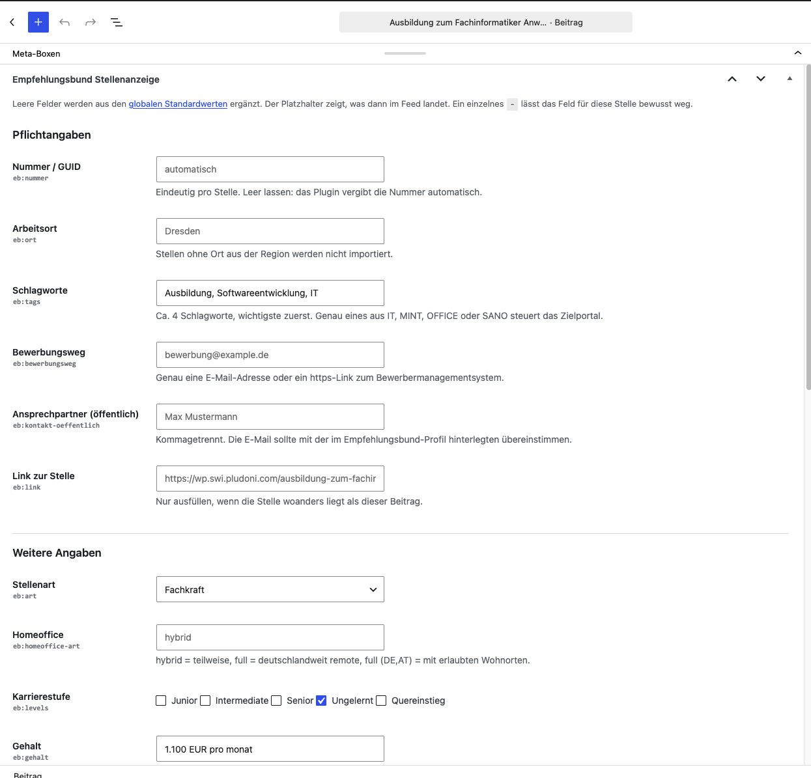
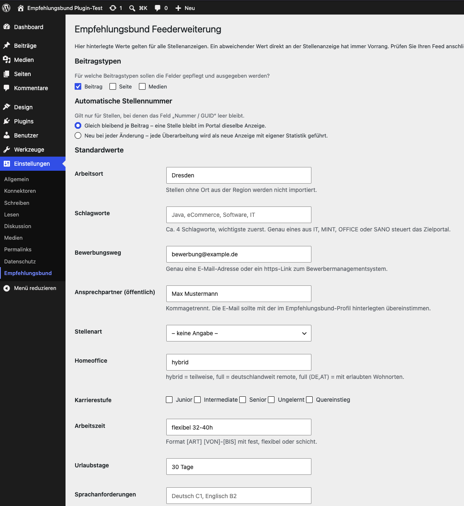
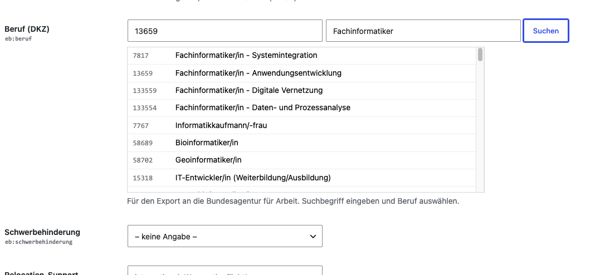

# Empfehlungsbund Feederweiterung für WordPress

Stellenanzeigen aus WordPress an den [Empfehlungsbund](https://www.empfehlungsbund.de) übergeben – und von
dort automatisch in über 35 angebundene Jobbörsen.

Der Empfehlungsbund liest Stellen über einen RSS-Feed ein. Den bringt WordPress zwar mit, aber ohne die
Angaben, die eine Stellenanzeige ausmachen: Arbeitsort, Bewerbungsweg, Gehalt, Homeoffice und so weiter.
Genau diese Felder ergänzt das Plugin – zur Pflege im Backend und zur Ausgabe im Feed.

**Sie schreiben die Stellenanzeige wie einen normalen Beitrag. Das Plugin macht einen importierbaren Feed daraus.**

---

## Was Sie damit machen können

### Stellen-Felder direkt am Beitrag pflegen

Unter dem Beitragstext erscheint die Box „Empfehlungsbund Stellenanzeige“ mit allen Feldern der
Feed-Spezifikation – sortiert nach Pflicht- und Zusatzangaben, jeweils mit Erklärung und Beispiel.



### Einmal Standardwerte setzen, statt alles doppelt zu tippen

Arbeitsort, Ansprechpartner, Bewerbungsweg, Urlaubstage – was für alle Stellen gleich ist, tragen Sie
einmal unter `Einstellungen → Empfehlungsbund` ein. An der einzelnen Stelle füllen Sie dann nur noch aus,
was davon abweicht.



### Den richtigen Beruf der Arbeitsagentur finden

Für den Export an die Bundesagentur für Arbeit wird eine DKZ-Berufs-ID benötigt. Statt sie
zusammenzusuchen, tippen Sie einen Suchbegriff ein und wählen aus der Liste aus. Ob in Ausbildungs- oder
Tätigkeitsberufen gesucht wird, ergibt sich automatisch aus der gewählten Stellenart.



### Bilder aus der Mediathek verwenden

Vorschau- und Bannerbild wählen Sie über die normale WordPress-Mediathek aus – hochladen, auswählen,
fertig. Die öffentliche URL landet automatisch im Feed. Eine externe Bildadresse können Sie stattdessen
auch direkt eintragen.

---

## Schnellstart

1. **Plugin installieren.** [ZIP herunterladen](https://github.com/pludoni/custom-fields-rss/archive/refs/heads/master.zip),
   unter `Plugins → Installieren → Plugin hochladen` einspielen und aktivieren.
2. **Standardwerte setzen.** Unter `Einstellungen → Empfehlungsbund` die Beitragstypen wählen und
   eintragen, was für alle Stellen gilt.
3. **Stelle anlegen.** Stellentext in den Beitrag, Zusatzangaben in die Box darunter, veröffentlichen.
4. **Feed prüfen.** Die Feed-Adresse (siehe unten) unter
   [login.empfehlungsbund.de/validator](https://login.empfehlungsbund.de/validator) eingeben.

Ein zusätzliches Plugin für benutzerdefinierte Felder wird nicht benötigt.

## Ihre Feed-Adressen

| Inhalt | Adresse |
| --- | --- |
| Alle Beiträge | `https://www.example.com/feed/` |
| Eine Kategorie | `https://www.example.com/category/IHRE-KATEGORIE/feed/` |

Der Empfehlungsbund erwartet getrennte Feeds für Praktikanten- und Ausbildungsstellen einerseits und für
Fach- und Führungskräfte andererseits. Legen Sie dafür einfach zwei Kategorien an und geben Sie deren
Feed-Adressen an.

So sieht eine Stelle im Feed aus – der obere Teil kommt aus dem Beitrag selbst, die `eb:`-Felder aus der
Box darunter:

```xml
<item>
  <title>Softwareentwickler Java für eCommerce-Lösungen (m/w/d)</title>
  <link>https://www.example.com/jobs/java-entwickler/</link>
  <pubDate>Mon, 03 Jan 2011 09:54:10 +0100</pubDate>
  <description><![CDATA[<p>Vollständiger Stellentext …</p>]]></description>

  <eb:nummer>post-42</eb:nummer>
  <eb:ort>Dresden</eb:ort>
  <eb:tags>Java, eCommerce, Software, IT</eb:tags>
  <eb:bewerbungsweg>bewerbung@example.com</eb:bewerbungsweg>
  <eb:kontakt-oeffentlich>Max Mustermann</eb:kontakt-oeffentlich>
  <eb:art>fachkraft</eb:art>
  <eb:homeoffice-art>hybrid</eb:homeoffice-art>
  <eb:beruf>13659</eb:beruf>
</item>
```

## Woher ein Feldwert kommt

Das ist die einzige Regel, die man kennen muss. Für jedes Feld gilt der Reihe nach:

1. **Der Wert an der Stellenanzeige.** Ist er leer, dann:
2. **Der globale Standardwert** aus den Einstellungen. Ist auch der leer, dann:
3. **Ein automatischer Wert**, falls es für das Feld einen gibt.

Der graue Platzhalter im Eingabefeld zeigt jeweils, was passiert, wenn Sie es leer lassen.

Automatisch ergänzt werden:

| Feld | Automatischer Wert |
| --- | --- |
| Nummer / GUID | Die Beitrags-ID, z. B. `post-42` |
| Link zur Stelle | Der Permalink des Beitrags |
| Social-Media-Bild | Das Beitragsbild, falls gesetzt |

**Ein Feld gezielt weglassen:** Tragen Sie ein einzelnes `-` ein. Dann wird weder der Standardwert noch
der automatische Wert verwendet, und das Feld fehlt im Feed. Praktisch etwa bei einer Schichtstelle, für
die „Homeoffice: hybrid“ aus den Standardwerten nicht passt.

### Zur Stellennummer

Die Nummer entscheidet, wie der Empfehlungsbund eine Stelle behandelt: Eine bereits bekannte Nummer wird
beim Import übersprungen, eine neue Nummer erzeugt eine neue Anzeige mit eigener Zugriffsstatistik. In den
Einstellungen legen Sie fest, was bei automatisch vergebenen Nummern gelten soll:

* **Gleich bleibend je Beitrag** – eine Stelle bleibt im Portal dieselbe Anzeige.
* **Neu bei jeder Änderung** – jede Überarbeitung wird als neue Anzeige geführt und separat ausgewertet.

Wer die Nummern selbst vergibt, trägt sie ins Feld ein; die Einstellung greift dann nicht.

---

## Feldreferenz

Maßgeblich ist immer die [Feed-Spezifikation im Validator](https://login.empfehlungsbund.de/validator).
Im Feed erscheinen die Felder mit dem Präfix `eb:`, also z. B. `<eb:ort>`.

### Pflichtangaben

| Feld | Bedeutung |
| --- | --- |
| Titel | Position, wichtigste Fachkompetenz und Anwendungsdomäne. Nicht „Softwareentwickler (m/w/d)“, sondern „Softwareentwickler Java für eCommerce-Lösungen (m/w/d)“. |
| Beitragstext | Der vollständige Stellentext. Einige Jobbörsen importieren erst ab etwa 1.000 Zeichen. Erlaubt sind die Formatierungen `p, q, strong, em, li, ol, ul`. |
| Veröffentlichungsdatum | Liefert WordPress automatisch. |
| `nummer` | Eindeutig pro Stelle, siehe oben. |
| `ort` | Arbeitsort. Stellen ohne Ort aus der Region werden nicht importiert. |
| `tags` | Etwa 4 Schlagworte, kommagetrennt, die wichtigsten zuerst. **Genau eines** davon steuert das Zielportal: `IT` (Softwareentwicklung), `MINT` (Maschinenbau, Mechatronik, Elektrotechnik, Physik, Chemie, Technik), `OFFICE` (kaufmännisch und Verwaltung) oder `SANO` (Gesundheits- und Sozialwesen). |
| `bewerbungsweg` | Genau eine E-Mail-Adresse oder ein https-Link zum Bewerbermanagementsystem. |
| `kontakt-oeffentlich` | Öffentlich angezeigte Ansprechpartner, kommagetrennt. Deren E-Mail sollte mit der im Empfehlungsbund-Profil hinterlegten übereinstimmen. Nur gemeinsam mit `bewerbungsweg` verwenden. |
| `kontakt` | **Veraltet**, nur nötig ohne `bewerbungsweg`/`kontakt-oeffentlich`. Erscheint in der Box nur, solange ein Wert hinterlegt ist. |

### Zusatzangaben

| Feld | Werte / Beispiel |
| --- | --- |
| `art` | `fachkraft`, `fuehrungskraft`, `freelancer`, `hilfskraft`, `praktikum`, `werkstudent`, `volunteer`, `ausbildung`, `weiterbildung`, `duales_studium` |
| `homeoffice-art` | `hybrid` (teilweise), `full` (deutschlandweit remote), `full (DE,AT,UK)` (mit erlaubten Wohnorten) |
| `levels` | `junior`, `intermediate`, `senior`, `ungelernt`, `quereinstieg` – Mehrfachauswahl möglich |
| `gehalt` | `30.000 EUR`, `30.000 EUR - 50.000 EUR pro Jahr`, `3.000-4.000 pro monat`, `15 EUR / h`. Ohne Zeiteinheit gilt ein Jahresgehalt. |
| `arbeitszeit` | `[ART] [VON]-[BIS]` mit `fest`, `flexibel` oder `schicht` – z. B. `fest 40h`, `flexibel 32-40h` |
| `urlaub` | `30`, `30 Tage`, `21-30 Tage` |
| `sprachen` | Sprache oder ISO-Code mit CEFRL-Level, maximal 3: `Deutsch C2, Englisch B2`, `de (B2)` |
| `beruf` | DKZ-Berufs-ID der Arbeitsagentur, per Suche im Feld auswählbar |
| `schwerbehinderung` | `geeignet` (auch für Schwerbehinderte) oder `exklusiv` (nur Schwerbehinderte) |
| `relocation` | `ZIELGRUPPE: FREITEXT` mit `international` oder `eu` – z. B. `international: We help you with the Blue Card and pay the flight!` |
| `og-image` | Vorschaubild für Social Media. JPEG, GIF oder PNG, empfohlen 1080px Breite, mindestens 600px. |
| `header-image` | Bannerbild in den Community-Portalen. JPEG, GIF oder PNG, empfohlen 1100px Breite. |
| `einrichtung` | Einrichtung oder Unterprofil – muss im Empfehlungsbund-Profil existieren. |
| `strasse-nr`, `plz`, `bundesland` | Nur nötig bei mehreren Standorten in einer Stadt oder wenn viele Orte dynamisch angelegt werden sollen. Sonst genügt `ort`. |

---

## Umstieg von Version 1.x

Version 1.x wurde zusammen mit dem Plugin
[Custom Field Template](https://wordpress.org/plugins/custom-field-template/) eingesetzt. **Bestehende Werte
bleiben erhalten** – die Box liest dieselben Felder. Groß- und Kleinschreibung spielt keine Rolle,
Unterstriche werden wie Bindestriche behandelt (`Homeoffice_Art` und `homeoffice-art` sind dasselbe Feld).
Beim Speichern eines Beitrags werden abweichende Schreibweisen zusammengeführt, damit ein Feld nicht
doppelt im Feed landet.

Custom Field Template kann danach deaktiviert werden. Die dort gepflegten `default`-Werte entsprechen den
Standardwerten unter `Einstellungen → Empfehlungsbund`.

## Bewerben-Button

Nutzen Sie das Bewerbermanagement des Empfehlungsbundes (EBMS), kann das Plugin jede Stelle direkt mit
ihrem Bewerbungsformular verlinken. Tragen Sie dazu unter `Einstellungen → Empfehlungsbund` Ihren
EBMS-Username ein. Der Link hat für alle Stellen dasselbe Muster, das EBMS erkennt die Stelle an ihrer
Nummer:

```
https://bms.empfehlungsbund.de/bewerbungen/start/<USERNAME>/<NUMMER>
```

Für die Ausgabe gibt es drei Wege:

| Weg | Wofür |
| --- | --- |
| Häkchen „Bewerben-Button unter dem Stellentext anzeigen“ | Ohne weiteres Zutun, für Themes ohne eigenes Stellen-Template. |
| `[eb_bewerben_button text="Jetzt bewerben"]` | Fertiger Link an beliebiger Stelle: Block „Shortcode“, klassischer Editor, Divi, WPBakery … |
| `[eb_bewerben_url]` | Nur die Adresse, für den Link eines Buttons im Page-Builder. |

Der Button bringt kein eigenes Design mit, sondern nur die CSS-Klasse `eb-bewerben-button`, damit er das
Aussehen des Themes übernimmt.

**Elementor:** Im Template für die Stellenanzeigen den Button anklicken, beim Feld „Link“ auf das Symbol für
dynamische Tags klicken, „Shortcode“ wählen und `[eb_bewerben_url]` eintragen. Die Shortcodes beziehen sich
immer auf die Stelle, die gerade angezeigt wird, und funktionieren deshalb auch in Übersichtslisten.

Wichtig:

* Das Feld „Link zur Stelle“ ist **nicht** für den Bewerbungslink gedacht und bleibt normalerweise leer.
  Der Empfehlungsbund zeigt die dort hinterlegte Seite als Stellenanzeige an.
* Neue Stellen kennt das EBMS erst nach dem nächsten Feed-Import. Bis dahin führt der Link zur
  Initiativbewerbung.
* Mit der Einstellung „Neu bei jeder Änderung“ ändert sich die Nummer nach jeder Bearbeitung. Bis zum
  nächsten Import findet das EBMS die Stelle dann nicht. „Gleich bleibend je Beitrag“ ist hier die bessere Wahl.

## Stellenseiten einbettbar machen

Unter den Stellenanzeigen in den Community-Portalen wird Ihre eigene Stellenseite als iFrame eingebettet.
Viele Webserver unterbinden das per `X-Frame-Options` oder `Content-Security-Policy`. Damit die Einbettung
funktioniert, muss `X-Frame-Options` entfernt und in der `Content-Security-Policy` eine Whitelist der
Portale hinterlegt werden. Die aktuelle Liste steht unten auf der
[Validator-Seite](https://login.empfehlungsbund.de/validator).

## Weiterentwicklung

Wie man eine Testinstanz startet, das Plugin per Filter erweitert und wie der Code aufgebaut ist, steht
in [DEVELOPMENT.md](DEVELOPMENT.md).

---

## Kompatibilität

WordPress 6.x und 7.x, PHP 7.4 bis 8.3, Block- wie klassischer Editor.

## Changelog

**2.2.0**

* Bewerben-Link ins EBMS: Shortcodes `[eb_bewerben_url]` und `[eb_bewerben_button]` sowie optional ein
  automatischer Button unter dem Stellentext.

**2.1.0**

* Box „Empfehlungsbund Stellenanzeige“ am Beitrag – kein zusätzliches Feld-Plugin mehr nötig.
* Globale Standardwerte unter `Einstellungen → Empfehlungsbund`.
* Automatische Werte für Nummer, Link und Social-Media-Bild.
* Bildfelder mit Mediathek-Anbindung, Berufsfeld mit Suche in der DKZ der Arbeitsagentur.
* Ein einzelnes `-` in einem Feld unterdrückt Standardwert und automatischen Wert.
* Filter `custom_fields_rss_field_schema`, `custom_fields_rss_value` und `custom_fields_rss_post_types`.
* Testinstanz per Docker Compose inklusive Beispiel-Stellenanzeigen.

**2.0.0**

* Fatal Error unter PHP 8 behoben – der Feed brach dort komplett ab.
* Nur noch die dokumentierten Empfehlungsbund-Felder werden ausgegeben; interne Daten anderer Plugins
  landen nicht mehr im öffentlichen Feed und erzeugen kein ungültiges XML mehr.
* Filter `custom_fields_rss_fields` zum Erweitern der Feldliste.
* Feldnamen werden normalisiert (`Homeoffice_Art` → `eb:homeoffice-art`).

**1.0**

* Erstveröffentlichung.

## Lizenz

GPL-2.0 · [pludoni GmbH](https://www.pludoni.de)
